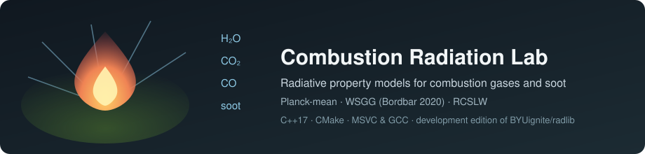

# Combustion Radiation Lab

<div align="center">
  
</div>

**Radiative heat-transfer property models for combustion gases and soot, as a
compact C++ library.** This is a development edition of
[BYUignite/radlib](https://github.com/BYUignite/radlib) — a radiative property
library for CFD of combustion systems. It is *not* a reacting-flow or
chemical-kinetics solver: it computes gray/weighted absorption coefficients
and weights for gas mixtures (H₂O, CO₂, CO, CH₄) and soot, which a radiation
solver then uses inside a CFD calculation.

## Capability overview

| Model | Class | Gases | Output | Notes |
| --- | --- | --- | --- | --- |
| Planck mean | `rad_planck_mean` | H₂O, CO₂, CO, CH₄, soot | 1 absorption coefficient | Optically thin limit; polynomial fits, 300–2500 K clamped |
| WSGG | `rad_wsgg` | H₂O/CO₂ mixtures, soot | 4 gray gases + clear gas (k, a per band) | Bordbar 2020 correlation; Mr interpolation to pure-species limits |
| RCSLW | `rad_rcslw` | H₂O, CO₂, CO, soot | nGG gray gases + clear gas (k, a per band) | Rank-correlated SLW; LBL-derived ALBDF tables (installed under `rcslw_data/`) |
| Interpolation | `LI_1D…LI_5D` | — | multilinear table interpolation | Header-only kernels used by the RCSLW lookup |

Common interface: every model implements `get_k_a(...)` and
`get_k_a_oneband(...)` on the abstract base class `rad` (`src/c++/rad.h`).

## Quick start (Windows / MSVC)

```powershell
cmake -S . -B build -G "Visual Studio 17 2022" -A x64 `
      -DCMAKE_INSTALL_PREFIX=build/installed -DRADLIB_BUILD_TESTS=ON
cmake --build build --config Release
cmake --install build --config Release     # populates rcslw_data for RCSLW
ctest --test-dir build -C Release --output-on-failure
```

## Quick start (Linux / macOS / GCC)

```bash
cmake -S . -B build -DCMAKE_INSTALL_PREFIX=build/installed -DRADLIB_BUILD_TESTS=ON
cmake --build build --parallel
cmake --install build
ctest --test-dir build --output-on-failure
```

Building and installing generates the binary RCSLW tables (`writebin.x` runs
as a post-build step) and installs headers, the shared library, the CMake
package, and the data files. Interfaces and examples are off by default;
enable them with the `BUILD_*` CMake options.

## Owner changes in this development edition (2026-10-18)

The upstream project targets Linux and macOS; this edition makes the core C++
library build and test cleanly on Windows with MSVC, and adds a numerical
test suite:

- **MSVC portability.** `_USE_MATH_DEFINES` (MSVC does not expose `M_PI` from
  `<cmath>` without it — `rad_rcslw.cc` failed to compile), `/W4` warnings
  for MSVC (`-Wall -Wextra` elsewhere), and `WINDOWS_EXPORT_ALL_SYMBOLS` so
  an import library is generated — without exported symbols the built DLL
  could not be linked against at all. `multilinear_interpolation.h` now
  includes `<algorithm>` for the `lower_bound` it uses.
- **Error paths report failure.** All library error exits used `exit(0)`,
  reporting failure to the operating system as success; they now use
  `exit(EXIT_FAILURE)`.
- **Test suite (`tests/`, 2 CTest cases).** Property/regression tests:
  exactness of `LI_1D`–`LI_4D` on linear fields (and linear continuation
  outside the grid), the analytic soot law `k = 1817·fv·T` for the Planck
  model, temperature clamping at the correlation bounds, linearity in mole
  fraction, WSGG weight partition of unity (sum = 1 to 1e-12) across all
  five Mr interpolation branches, the uniform per-band soot increment,
  RCSLW weight summation and soot monotonicity, and pinned regression
  anchors. Plus a `WILL_FAIL` test asserting an invalid band index exits
  nonzero (it exited zero before the fix).
- Build hygiene: generated `data/rcslw_data/*.bin` files are ignored.

Verified 2026-10-18 with MSVC 19.44 and CMake 3.31: `2/2` CTest cases pass
after `cmake --install`. The GCC/Clang path is unchanged upstream code and
not re-verified in this batch.

## Limitations

- This edition was built and tested on Windows/MSVC only; the Linux/macOS
  path is upstream code and believed unchanged, but not re-verified here.
- The `LI_*` interpolation kernels continue the end interval linearly
  *outside* the table range (they do not clamp); radlib's own RCSLW path
  clamps its inputs before lookup. Users calling the kernels directly
  should clamp inputs themselves.
- The tests check structural invariants, exact analytic sub-cases, and
  pinned reference values; they do not re-derive the fitted correlations
  or validate the ALBDF tables against line-by-line data.
- WSGG is a correlation with bounded validity (temperature clamped to
  300–2400 K; molar-ratio branches interpolate to pure-species limits).
- Model behavior for RCSLW fixes pressure and soot at construction; passing
  different per-call values is not consistent usage.

## Upstream source and credits

- Original project: [BYUignite/radlib](https://github.com/BYUignite/radlib)
  (MIT license, retained unchanged; see `LICENSE`).
- Upstream publication (please cite when using the models):
  V. B. Stephens, S. Jensen, I. Wheeler, D. O. Lignell, “RadLib: a
  radiative heat transfer model library for CFD,” *Computer Physics
  Communications*, [272:108227](https://doi.org/10.1016/j.cpc.2021.108227)
  (2022). A `CITATION.cff` is included (upstream authors).
- Upstream documentation: [ignite.byu.edu/radlib_documentation](https://ignite.byu.edu/radlib_documentation);
  a [Code Ocean capsule](https://codeocean.com/capsule/0997975/tree/v2) and a
  [build/demo video](https://www.youtube.com/watch?v=z82ENE5fPoE) are
  available.
- This repository preserves the upstream Git history, source authorship, and
  license; the improvements above are the only owner-authored changes.
